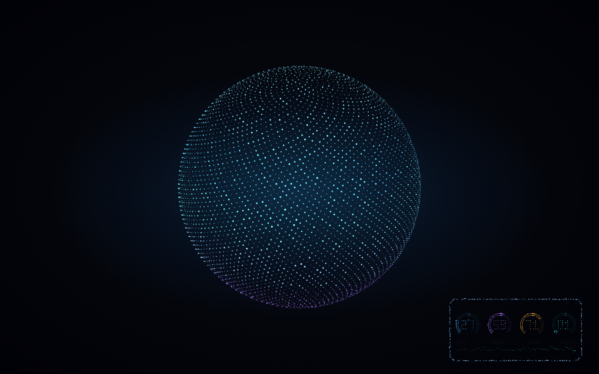
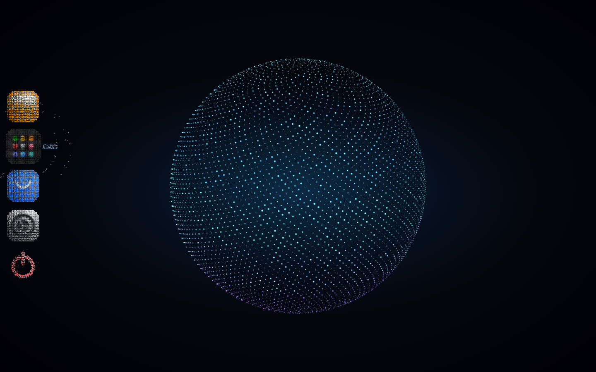
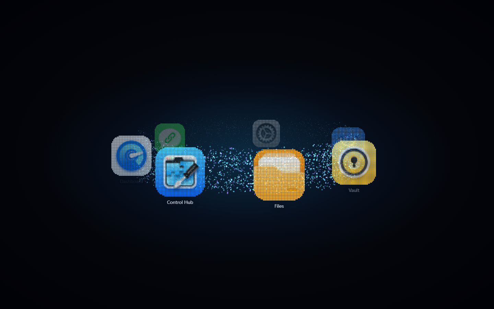
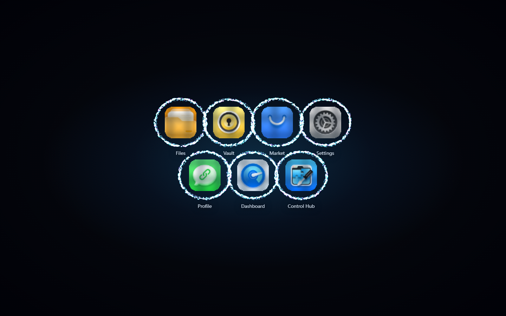
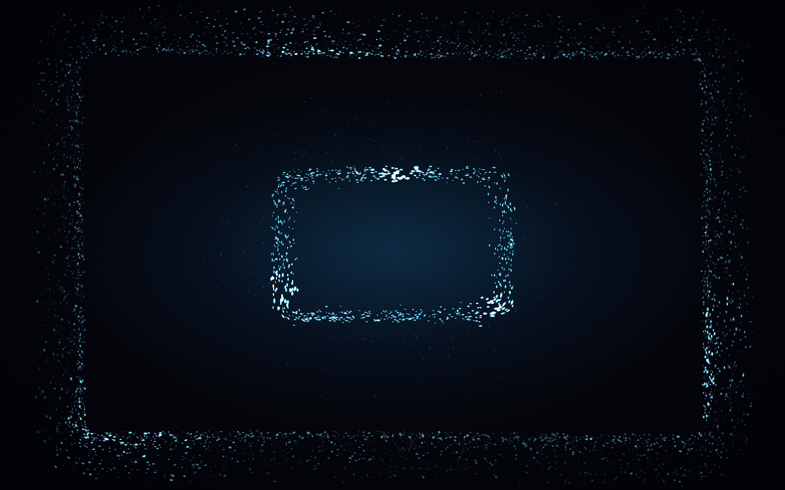
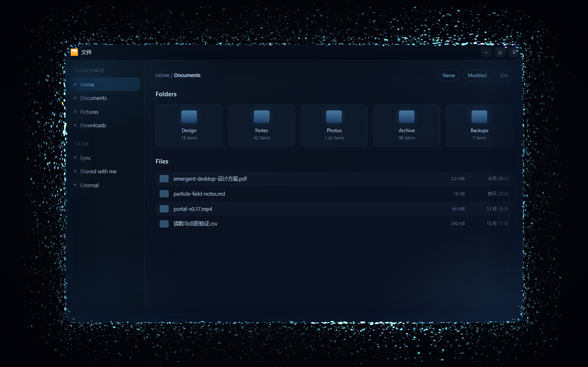
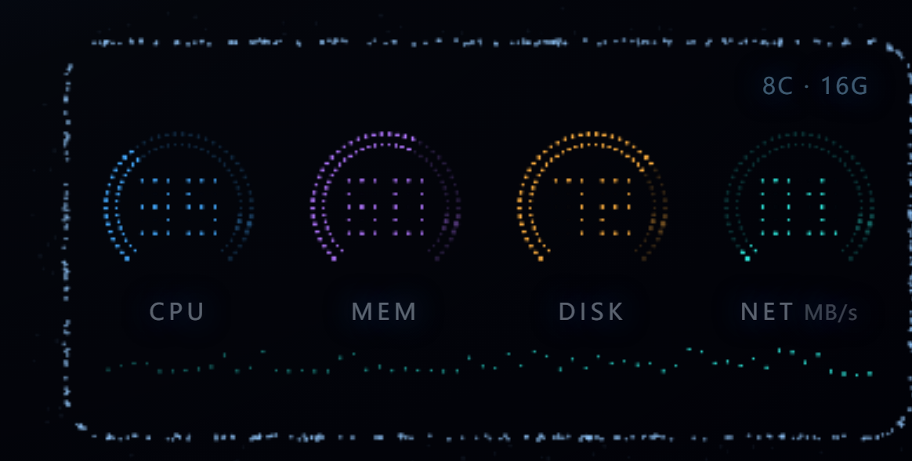

# 涌现式桌面 · Emergent Desktop

> 桌面不是一张图，是一团一直在动的粒子；窗口不是被「打开」的，而是从这团粒子里长出来的。

给 [Olares](https://github.com/beclab/Olares) 社区版做的一套**涌现式桌面外壳**。整屏只有一团粒子：
应用栏、启动台、窗口边框、设备仪表盘，全都是这一团沿着螺旋粒子流「流」出去成形，用完再逆流回来。

没有常驻图标、没有硬边窗口、没有提示文案。



Three.js · 无框架、无构建 · MIT

---

## 操作一览

桌面平时**一个字都没有**——这是有意的，所以把全部操作列在这里。

### 桌面

| 操作 | 怎么触发 | 会发生什么 |
| --- | --- | --- |
| 旋转视角 | 在空白处**按住左键拖动** | 整团跟着转（水平绕 Y、上下调俯仰）；松手带惯性，约 1 秒停住 |
| 自动换形态 | 不用管 | 每 9 秒在 球 / 环面 / 五臂星系 / 网格涟漪 之间重组一次（0.9s 先收拢再展开） |
| 心跳 | 不用管 | 每 1.05~1.9 秒猛抽搐一下：整体放大 7.5% + 粒子被撕向两侧，0.35s 复原 |
| 全屏 | `F` | 进入全屏；再按 `F` 或 `Esc` 退出 |

### 左边缘 · 应用栏

| 操作 | 怎么触发 | 会发生什么 |
| --- | --- | --- |
| 唤出 | 鼠标贴到屏幕最左边（**26px** 触发带） | 粒子汇聚成 4 个图标 + 登出，竖排并**整体垂直居中**（官方是从顶部起排，这里项少，居中更稳） |
| 看名字 | 悬停某个图标 | 名字浮出，同时外圈的余量粒子被吸进来绕着它浮 |
| 打开应用 | **点图标** | 图标炸开散回团里，同一时刻一条粒子流从**这个图标的方向**流进屏幕中心 → 粒子门开窗 |
| 打开启动台 | 点第 2 个（启动台） | 进入 3D 圆环画廊，见下一节 |
| 登出 | 点最下面那个红色电源图标 | 退出登录，回登录页 |
| 收起 | 鼠标离开（**220ms** 宽限） | 整栏沿原路逆流回团里，而不是「淡出」 |

图标清单照抄官方 `get_default_dock_list()`：**只有 文件 / 启动台 / 应用市场 / 设置 4 项 + 登出**。
新装的应用不会自动进来，只在启动台里出现。

### 应用列表（启动台）

| 操作 | 怎么触发 | 会发生什么 |
| --- | --- | --- |
| 进 3D 圆环 | 在桌面上**按住左键左右快速甩两下**（拖动过程中判，**不用松手**） | 图标从团里飞出来，沿一个水平圆环排开，外侧一层粒子流裹着转 |
| 转圆环 | 按住左右拖 | 展示环跟着转，松手带惯性 |
| 切 2D 平铺 | 再甩两下 | 图标落到网格里，**每个图标外面绕上一圈粒子流** |
| 平铺里拖 | 按住左右拖 | 整块网格橡皮筋位移，松手弹回 |
| 回桌面 | 再甩两下，或按 `Esc` | 图标逆流回团里 |
| 打开应用 | 点图标 | 列表散开 + 开窗（圆环上前后的图标会重叠，点击按投影位置 + 深度判定） |

一次「甩」的判据：横向主导、瞬时速度 > 700px/s、同向累计 ≥ 88px 且 < 460ms；
一段只记一次，要反向/减速/停手 > 220ms 才能开新的一段。

### 窗口

| 操作 | 怎么触发 | 会发生什么 |
| --- | --- | --- |
| 移动 | 拖标题栏 | 窗口跟手，粒子边框随之流动 |
| 关闭 | 点右上 `×` | 2.4s：整框散开 → 就近聚成 6 条小流 → 汇成一条 → 被中心的团吸收 |
| 最小化 | 点 `–` | 窗口隐去，边框粒子回流 |
| 最大化 / 还原 | 点 `□` | 视口留 8px 边的一整块；粒子自动收成贴着屏幕边的一条，不压内容 |
| 置前 / 恢复 | 再点一次同一个应用的图标 | 已开着就置前；最小化的会重新长出来 |
| 最多 3 个窗口 | — | 第 4 个会先把最早的那个关掉 |

### 右下角 · 设备状态

| 操作 | 怎么触发 | 会发生什么 |
| --- | --- | --- |
| 唤出 | 鼠标移到右下角（**168px** 触发区；有窗口时收成 120px） | 粒子从团里抽一条流 → 收到角落一点 → **整体摊开**成仪表盘（2.1s） |
| 收起 | 鼠标移开 | 沿原路逆流回团 |
| 读数 | — | CPU / MEM / DISK / NET 四个 270° 环 + 环心 3×5 点阵数字 + 底部 60 点流量走势线 |
| 告警 | 负载 > 82% | 环**和数字**一起转告警红；NET 满量程 25 MB/s，读数单位 MB/s |

数据取自官方桌面自己用的那个接口，见下文「设备状态的数字是真的」。

### 键盘

| 键 | 行为 |
| --- | --- |
| `F` | 切全屏 / 退全屏 |
| `Esc` | 按优先级逐个退：退出应用列表 → 收起应用栏 → 关闭最上层窗口（焦点在 iframe 里时不响应，不会误关应用） |

### 调试用 URL 参数

| 参数 | 作用 |
| --- | --- |
| `?debug=1` | 挂出 `window.__em = { field, rail, launch, status, wins }`，方便用 CDP 量粒子状态 |
| `?stat=1` | 启动后自动展开右下角设备状态（不用把鼠标挪到角落） |
| `?open=<id 或标题关键字>` | 启动后直接开某个应用的窗口 |

---

## 它是怎么长的

### 一团，只有一团

所有东西都来自**同一团粒子**。要出现一个交互物，就从团里抽出一条带螺旋缠绕的流飞过去；
要消失就沿**同一条路径**逆流回来——所以进场和退场是同一个手感，不会一个「长出来」一个「炸掉」。

流的参数写死在 `streamXY()` 里：管内匀速（`e = 0.94u + 0.06u²`，不用 ease，ease 会让中段一闪而过）、
管径 `sin(πu)` 两端收束、每颗粒子沿法向偏移 `cos(sw·2πu + ph)` 绕出螺旋。
同一个交互物的所有点共用 `sw/ph`，管壁亮带才连得成一条螺旋线。

### 左边缘应用栏



图标不是画出来的字形，是**直接采样官方 `icon.png`**：缩到 32×32，每格取一个颜色一个点，
所以形状和配色就是官方图标本身。它单独一层、走普通透明混合——加法混合会把密集点叠成一团白。

### 应用列表：3D 圆环 → 2D 平铺

圆环画廊：图标沿一个水平圆排开，外侧一层粒子流裹着它们转，可左右拖动。



再甩两下变成 2D 平铺。**每个图标外面绕着一圈粒子流**：椭圆上分布几百颗点，逐粒角速度不同所以环会「拧」起来，
三个彗头沿周长跑（头部亮、后面拖着尾巴），点还按运动方向拉成流线——静止画面也看得出在往哪边流。



### 粒子门：窗口从粒子里长出来

开窗不是淡入也不是缩放：一条流从团里抽出来 → 收到窗口中心的**一点** → 粒子绕着这一点**不断环流** →
一边流一边放大成窗口（2.45s），撑到 72% 才让 iframe 的内容析出。

「环流」不是「窗口在转」：形状由进度决定——小尺寸是**正圆**（圆角＝半径），长到一半被拉成窗口长宽比、
圆角收到 18px；每颗粒子沿周长一直推进（速度按 `√(周长比)` 折，小尺寸时不会快成频闪），
三道亮波沿周长跑。小团阶段把法向厚度撑开成蓬松球，定型后收成一条细边。



关窗反过来：整框先散开 → 就近聚成 **6 条小流** → 汇成一条大流 → 被中心的团吸收。
每颗粒子错峰出发，任何时刻都摊满整条路径——否则上千颗点同时到达汇合点，看到的是「一个大圆点瞬间生成」，不是流。

### 开窗之后：让开内容

窗口占着的那块**不画任何粒子**。剩下的全部改道到窗口外缘的一圈「日冕」，贴着边框 8~84px 往外流，
沿周长漂 + 三道亮波；余量不够时自动收窄（最大化的窗口只剩贴着屏幕边的一条）。

早先还有一小撮粒子跟着光标、允许进到中央（想的是"光标周围也有粒子"），已经去掉了：
iframe 是跨域的，指针一进去父文档就再也收不到 `pointermove`，坐标会冻在跨过边界那一点——
粒子不跟手比没有还难受。所以中央干脆一颗都不留，光标交给系统。



### 右下角设备状态

和左边缘应用栏同一套逻辑：不常驻，贴到角落才流出来。内容是粒子画的四个 270° 环形表、
环心的点阵数字、底部的流量走势线，边框本身也在沿周长环流。



#### 设备状态的数字是真的

调用的是官方桌面自己用的那个接口（从 `/www/desktop/js/app.js` 的 `getMonitorInfo()` 里挖出来的）：

```
GET /api/users/monitor/cluster        # Olares 1.12.3+
GET /bfl/monitor/v1alpha1/cluster     # 老路径 / 兜底
→ { code: 0, data: { cpu, memory, disk, net } }
   cpu/memory/disk = { total, usage, ratio }   net = { received, transmitted } 字节/秒
```

指标和人家的 Dashboard 完全一致，没有自己造。同源 + cookie 直接取，两条路径按顺序试、成功的那条记住。
拿不到时（本地没登录态联调）自动退回模拟值，`__em.status.src.mode` 会标出 `live` / `sim`。
面板右上角的 `8C · 16G` 也是真的，来自免登录的 `/api/system/status`。

> 为了让它在这套壳里能同域取到，`deploy/shell-k8s.yaml` 给 `/bfl/` 单独开了一条 `proxy_pass` 直连 bfl 网关——
> 官方前端 pod 自己不代理 `/bfl`（桌面是跨域走 auth 域名 + JWT 的）。

---

## 实现要点

| 点 | 做法 |
| --- | --- |
| 粒子规模 | 常驻约 1.8 万颗：环境 6400 / 每个窗口的边框 1200×3 / 应用栏 6×1080 / 状态盘 1400；启动台按图标数量另开一层（每个图标一个 `Points`，这样才能按深度排序、前面的图标挡住后面的） |
| 渲染 | 一个正交相机的 Three.js 场景，混合分三套：背景粒子走加法但不写 alpha（`AdditiveBlending` 会把 alpha 加满，白底 iframe 上会变成黑点）、应用栏和图标走普通透明（配色不能叠白）、流线把点精灵沿切线拉长 |
| 点阵字体 | 离屏采样 → 覆盖率阈值 → 1:1 格心点阵；格距与可见芯径的比值决定「断 / 连 / 糊」 |
| 窗口 | 每个窗口一组 `1200` 颗边框粒子，开合各一套时间轴；DOM 那层只管 iframe、标题栏和毛玻璃 |
| 帧率 | 桌面 61fps / 平铺 51fps / 带窗口 24fps（瓶颈是 iframe 的 `backdrop-filter`，不是粒子） |

一些踩过的坑写在 `prototype/CHANGELOG.md` 和代码注释里，比如：

- `gl_PointSize = size × (屏高/2) / 距机位`，**不含 fov 修正**，实际像素直径约为世界尺寸推算值的一半；
- `renderer.setSize(W, H, false)` 在高 DPI 下会让整屏粒子缩到右下角；
- `.win { opacity: 0 }` 不足以让窗口消失——`backdrop-filter` 不跟祖先 opacity 走，得配 `visibility: hidden`。

---

## 目录结构

```
emergent-desktop/
├── shell/                     桌面壳层（当前主线，裸 Pod 部署的就是它）
│   ├── index.html             入口
│   ├── src/main.js            启动、甩动计数、窗口管理、快捷键
│   ├── src/field.js           粒子场：形态 / 应用栏 / 粒子门 / 启动台 / 状态盘（约 2000 行）
│   ├── src/rail.js            左边缘应用栏（官方 dock 白名单）
│   ├── src/launcher.js        启动台（圆环 / 平铺）
│   ├── src/status.js          设备状态盘的点阵布局 + 数据源
│   ├── src/icons.js           官方 icon.png → 点阵采样
│   ├── src/window.js          窗口 DOM（iframe / 标题栏 / 毛玻璃 / 揭示进度）
│   ├── test-*.html            单模块调试页（field / rail / launch / door）
│   └── vendor/                Three.js 本地副本
├── auth/                      粒子登录页（界面全部由点阵粒子构成）
├── prototype/                 早期技术原型（形态系统 / 粒子 UI / 粒子门的原型）
├── deploy/                    k8s 清单 + 一键切换脚本（官方桌面 ⇄ 涌现式桌面）
├── tools/portal-inject/       外挂注入调试链路（Tampermonkey + 本地热更）
├── tools/dev/                 本地开发脚本：mock 服务（假 myApps）+ README 截图
├── docs/                      需求评估、原型移交说明、本文的截图
└── LICENSE                    MIT
```

---

## 本地跑起来

壳层依赖一个 `POST /server/myApps` 拿应用列表。没有登录态时用一个**假接口**就能把整条链跑通：

```bash
node tools/dev/mock-shell.mjs 8778
# → http://127.0.0.1:8778/            完整桌面（假应用列表）
# → http://127.0.0.1:8778/?debug=1    挂出 window.__em
# → http://127.0.0.1:8778/?stat=1     自动展开设备状态
# → http://127.0.0.1:8778/test-door.html?open=150&close=4300   单独调粒子门
```

纯静态起服务也可以（`cd shell && python -m http.server 8778`），只是 `myApps` 拿不到、会被踢去登录页。

README 里的截图全部由脚本生成，不是手截的：`node tools/dev/shots.mjs` 会在一条会话里依次
摆出桌面 / 应用栏 / 圆环 / 平铺 / 粒子门 / 开窗 / 状态盘七个状态并逐张截图（走 CDP 的真实鼠标事件）。

早期原型不依赖任何构建，起个静态服务器就能看：

```bash
cd prototype && python -m http.server 8765
# → http://localhost:8765/index.html     粒子群 + 粒子 UI
# → http://localhost:8765/portal.html    粒子门原型
```

---

## 部署到 Olares

不改进官方镜像：另起一个 pod 只接管「桌面入口」，其余请求（`/api` `/server` `/kapis` `/bfl` …）
全部反代回官方前端 pod，再靠 Service 的 selector 在**官方桌面**和**涌现式桌面**之间秒级切换。
静态文件走 hostPath，改完 `scp` 即可，不用重启 pod、不用打镜像。

```bash
kubectl apply -f deploy/shell-k8s.yaml
scp -r shell/* root@HOST:/olares/emergent-shell/www/
deploy/switch.sh desktop dev        # 切到涌现式桌面
deploy/switch.sh desktop official   # 切回官方
deploy/switch.sh status             # 看当前指向哪边
```

完整说明（为什么用裸 Pod、ConfigMap 是 subPath 挂载必须重建 pod、`/bfl` 为什么要单独代理）见
[`deploy/README.md`](deploy/README.md)。

---

## 状态

**已完成**

- [x] 粒子体：4 种形态自动重组、呼吸 + 心跳、拖动旋转视角
- [x] 左边缘应用栏：官方图标点阵、悬停增援、粒子流进出
- [x] 粒子门：开窗环流放大 / 关窗多条小流汇聚，内容从雾里析出
- [x] 应用列表：甩动进 3D 圆环 → 2D 平铺，逐图标一圈粒子流
- [x] 开窗后粒子让开内容：全部改道到窗口外缘的日冕，中央一颗不留
- [x] 右下角设备状态：官方遥测接口 + 点阵仪表盘
- [x] 全屏、注入式调试链路、不改进官方镜像的部署与切换

**没做 / 已知限制**

- [ ] 窗口不能拖边缘改大小（固定 78%×76%，只能最大化 / 还原）
- [ ] 同时最多 3 个窗口，第 4 个会挤掉最早的
- [ ] 甩动手势是为鼠标设计的；触摸只做了基础的 pointer 事件支持
- [ ] 低端 GPU / 软渲染下的降级策略（目前没有质量档位）
- [ ] 接入官方 Vue 3 + Quasar 栈，做成可安装的社区版镜像

---

## 文档

- [`prototype/README.md`](prototype/README.md) —— 原型完整技术说明：物理、参数表、验证方法
- [`prototype/CHANGELOG.md`](prototype/CHANGELOG.md) —— 逐版变更，含「为什么这么改」与被推翻的方案
- [`docs/原型移交说明.md`](docs/原型移交说明.md) —— 验收基线、代码复用度、接入官方仓库的改造点、风险清单
- [`docs/Olares涌现式UI需求文档-评估报告.md`](docs/Olares涌现式UI需求文档-评估报告.md) —— 需求评估
- [`deploy/README.md`](deploy/README.md) —— 部署与切换

---

## 协议与上游说明

本项目自身代码以 **MIT** 发布，见 [LICENSE](LICENSE)。

上游 [Olares](https://github.com/beclab/Olares) 采用 **AGPL-3.0** 并附带额外的 `LICENSE.md`（限制商用）。
本仓库**不包含任何上游代码**，只通过反代与运行中的 Olares 协作（图标是运行时从官方 CDN 取的）。
一旦将来把上游代码并入本仓库，相关目录的协议会随之调整并在该目录内单独声明。

「Olares」是其所有者的商标，本项目为社区独立实验，非官方项目。
